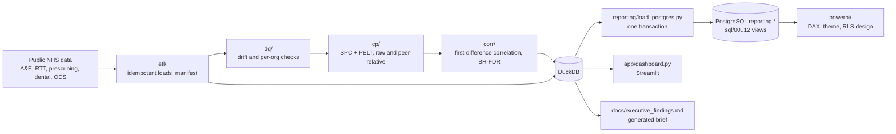

# NHS Monitoring Copilot

[](https://github.com/Katy-Kittivibul/NHS-Monitoring/actions/workflows/ci.yml)

NHS performance data is public, but it is scattered across CSV, Excel and JSON files that use different
geographies, so "A&E got worse at this trust, what else changed?" takes hours of manual joining. This
project loads four public NHS datasets (A&E, elective waiting times, GP prescribing, NHS dental) into one
database, checks the data, flags real shifts in performance, tests whether services move together, and
serves the result to a Streamlit dashboard and a Power BI star schema.

It describes association on observational data. Nothing here shows that one service's pressure causes another's.

## Headline findings

From [`docs/executive_findings.md`](docs/executive_findings.md), generated by `make brief` (every figure is a query; as of August 2026):

1. **A&E is well short of its target.** 74.5% of attendances were seen within 4 hours against a national target of
   82%; about 205,000 breaches above what the target allows in the month, and 109 of 191 providers over their allowance.
2. **52+ week elective waits are concentrated.** 105,918 patients had waited 52 weeks or more, and ten treatment
   functions account for 81.5% of them (Trauma & Orthopaedics, Gynaecology and ENT lead).
3. **Most apparent cross-service links do not survive multiple-testing control.** Trust-level A&E vs RTT
   correlations (month-on-month changes): 217 of 3,078 pass p < 0.05, about 154 would be expected by chance, and
   5 remain after Benjamini-Hochberg false-discovery-rate control. At region level 0 of 168 survive. The honest
   reading is that this much data cannot support a strong claim either way.

Also worth knowing: the changepoint detector's original penalty reported a spurious shift in roughly 50-60% of
pure-noise series. I measured it, doubled the penalty (now under 10% on noise, still finds 2-sigma steps), and pinned
that calibration in `tests/test_cp.py`.

## Try it in 60 seconds (no downloads)

```bash
pip install -r requirements.txt
make demo            # builds a small synthetic DuckDB and serves the dashboard on it
```

`make demo` uses made-up numbers with real trust, ICB and region codes, so it exercises every page and view.
Without `make`: `python tests/fixtures/build_fixture_db.py data/processed/fixture.duckdb`, then
`NHS_DB_PATH=data/processed/fixture.duckdb streamlit run app/dashboard.py`.

## Architecture



## Quickstart (real data)

```bash
pip install -r requirements.txt
make pipeline        # etl -> dq -> cp -> corr   (raw files go in data/raw/; see docs/schema_notes.md)
make tier3           # optional, needs internet: one NHS ODS API call per trust
make brief           # regenerate docs/executive_findings.md
make dashboard       # streamlit run app/dashboard.py
make reporting       # needs .env (copy .env.example): load PostgreSQL and apply the views
docker compose up    # pipeline then dashboard on :8501;  --profile reporting adds PostgreSQL
make test            # full suite;  make lint
```

`make help` lists every target. On Windows run `make` under Git Bash, or call the Python commands directly.
Fetching newer raw files: `python -m etl.download --datasets dental` (plain HTTP); A&E and RTT need a browser
(`pip install -e ".[ingest]" && playwright install chromium`); prescribing is a manual download (`docs/schema_notes.md`).

## What each track shows

**Data engineering**
- Idempotent ETL: a manifest watermark skips unchanged files; `--force` reloads. Raw layouts that changed over time
  (a dental billing code that split in 2022, a totals row that doubled a month's national attendances) are handled
  and tested.
- `pipeline_runs` audit log, and per-organisation data-quality checks (a trust dropping out for one month is invisible to a
  dataset-wide row count; it is caught here).
- Transactional full-refresh load from DuckDB to PostgreSQL: a failed load leaves the previous schema intact.
- CI: lint, a hermetic test job with a coverage floor, a Postgres job that loads the synthetic fixture and fails on
  unexpected skips, and a Docker build that starts the dashboard and checks its health endpoint.

**Data analysis**
- Control charts (XmR) and PELT changepoints on A&E and RTT, each on the trust's own series and on a peer-relative
  series (trust minus the national value for the month). A raw changepoint is `is_robust` when the peer series also shifts
  within a month, i.e. it is not just the national or seasonal pattern.
- Correlations use month-on-month changes, not levels (trending series correlate spuriously), report a Fisher-z 95%
  interval, and control the false-discovery rate within each test family (`corr/inference.py`). A simulation test
  shows level correlations produce over 20% false positives on trending noise and the FDR procedure stays under 8%.
- Language is association-only; the generated brief is snapshot-tested and a test bans causal wording.

**Business intelligence**
- Reporting star schema in PostgreSQL (`sql/`, 13 views): conformed date and trust dimensions, A&E and RTT facts
  against the national target, XmR, benchmarks, changepoints, correlations, primary-care context and pipeline health.
- `powerbi/`: DAX measure library with volume-weighted ratios, NHS theme, data dictionary with grain and non-additivity
  rules, and an RLS design. The `.pbix` is a binary and is not committed; see `powerbi/DATA_DICTIONARY.md` for saving as PBIP.
- Streamlit dashboard: Executive Overview plus one page per analysis stage.

## Design decisions and limitations

- **Why not dbt?** About a dozen views, applied in order inside the load transaction and covered by pytest, do not justify a
  second toolchain and profile to maintain. Revisit if the model grows.
- **Short series.** A&E and RTT cover March 2024 to August 2026 (30 months); correlation windows hold 6 paired
  changes, so intervals are wide and every correlation row is flagged exploratory.
- **Primary care lags.** Prescribing and dental end in March 2025 in the loaded data, so comparisons involving them
  use only overlapping months.
- **Public, aggregated data.** Figures are provider or ICB aggregates and say nothing about individual patients.
  Mergers, ICB boundary changes and reporting changes can look like real shifts.
- **Roadmap (deliberately not built):** dbt, orchestration (Airflow/Dagster), cloud deployment, forecasting.

## Project layout

```
.
├── etl/            load and clean the raw datasets (reference/ holds lookup tables)
├── dq/             data-quality drift and per-organisation checks
├── cp/             SPC and PELT changepoint detection
├── corr/           cross-dataset correlation and false-discovery-rate control
├── reporting/      PostgreSQL loader, view applier, executive brief generator
├── sql/            reporting views, applied in numeric order by run_all.sql
├── app/            Streamlit dashboard and its queries
├── powerbi/        DAX measures, theme, data dictionary, RLS design
├── docs/           schema and method notes, generated executive brief
├── tests/          test suite; fixtures/ builds the synthetic demo/CI database
├── .github/        CI workflow
├── data/           raw downloads and the DuckDB file (not in git)
├── Makefile  Dockerfile  docker-compose.yml  pyproject.toml  requirements.txt
└── LICENSE  README.md  .env.example
```

## Licence and data attribution

Code: MIT (see `LICENSE`). Data: contains public sector information from NHS England, NHS Business Services
Authority, OpenPrescribing and NHS Digital (ODS), licensed under the
[Open Government Licence v3.0](https://www.nationalarchives.gov.uk/doc/open-government-licence/version/3/).
Check each publisher's terms before redistributing extracts.
