# NHS Monitoring Copilot — BI Semantic Model & Data Dictionary

This document specifies the star-schema model, grain contracts, KPI definitions, non-additivity rules, and Row-Level Security (RLS) design backing the Power BI report in `powerbi/`.

---

## 1. Star-Schema Entity-Relationship Diagram

All Power BI queries import from the `reporting` schema in PostgreSQL (populated atomically from DuckDB via [load_postgres.py](file:///e:/Coding%20Projects/NHS/reporting/load_postgres.py) and shaped by [sql/](file:///e:/Coding%20Projects/NHS/sql/run_all.sql)).

```mermaid
erDiagram
    vw_dim_date ||--o{ vw_ae_performance : "month_date (1:*)"
    vw_dim_date ||--o{ vw_rtt_performance : "month_date (1:*)"
    vw_dim_date ||--o{ vw_rtt_specialty : "month_date (1:*)"
    vw_dim_date ||--o{ vw_spc_xmr : "month_date (1:*)"
    vw_dim_date ||--o{ vw_benchmark : "month_date (1:*)"
    vw_dim_date ||--o{ vw_data_quality : "month_date (1:*)"

    vw_dim_trust ||--o{ vw_ae_performance : "org_code (1:*)"
    vw_dim_trust ||--o{ vw_rtt_performance : "org_code (1:*)"
    vw_dim_trust ||--o{ vw_rtt_specialty : "org_code (1:*)"
    vw_dim_trust ||--o{ vw_spc_xmr : "org_code (1:*)"
    vw_dim_trust ||--o{ vw_benchmark : "org_code (1:*)"

    vw_dim_date {
        date month_date PK "First of month (e.g. 2026-08-01)"
        int calendar_year
        int month_number
        text month_name
        text month_label "Mon YYYY"
        int year_month "YYYYMM sort key"
        text financial_year "April-March (e.g. 2026/27)"
        int fy_month_number "1=April .. 12=March"
        text fy_quarter "Q1..Q4"
        boolean is_latest_month
    }

    vw_dim_trust {
        text org_code PK "ODS provider code (e.g. RXC)"
        text trust_name
        text provider_type "NHS trust | Other provider"
        text region_code "Y56..Y63 | UNKNOWN"
        text region_name "7 NHS England regions | Unknown"
        text icb_code "ODS ICB | MULTI | UNMAPPED"
        text icb_name
        text icb_mapping_status "Resolved | Multiple ICBs | Unmapped"
        boolean has_type1_ae
        boolean is_active
        boolean specialist_no_ae
    }

    vw_ae_performance {
        text org_code FK
        date month_date FK
        bigint attendances
        bigint within_4hr
        bigint breaches_4hr
        double performance_pct
        double national_target_pct "76 / 78 / 82 by FY"
        bigint type1_attendances
        bigint type1_breaches_4hr
    }

    vw_rtt_performance {
        text org_code FK
        date month_date FK
        bigint waiting_list_size "C_999 total only"
        bigint within_18wk
        bigint over_18wk
        bigint waiters_52wk_plus
        double pct_within_18wk
    }

    vw_rtt_specialty {
        text org_code FK
        text specialty_code "Excludes C_999"
        date month_date FK
        text specialty_name
        bigint waiting_list_size
        bigint within_18wk
        bigint waiters_52wk_plus
    }

    vw_spc_xmr {
        text org_code FK
        text measure "AE_4HR_PERFORMANCE | AE_4HR_TYPE1 | RTT_18WK_PERFORMANCE"
        date month_date FK
        double value
        double mean_value
        double upper_limit
        double lower_limit
        boolean outside_limits
        boolean run_of_7_plus
    }

    vw_benchmark {
        text measure
        text org_code FK
        date month_date FK
        double trust_pct
        double region_pct
        double national_pct
        int rank_in_region
        int rank_national
    }

    vw_data_quality {
        text dataset
        date month_date FK
        text check_name
        text status "FAIL | WARN | OK"
        int severity_order
        boolean is_issue
        bigint flag_count
    }
```



---

## 2. View Grain & Critical Non-Additivity Rules

| View | Exact Row Grain | Primary Key (Logical) | Critical Modelling & Aggregation Rules |
| :--- | :--- | :--- | :--- |
| [vw_dim_date](file:///e:/Coding%20Projects/NHS/sql/01_dim_date.sql) | 1 row per calendar month | `month_date` | Mark as **Date Table** in Power BI on `month_date`. Sort `month_label` by `year_month` and `month_name` by `month_number`. |
| [vw_dim_trust](file:///e:/Coding%20Projects/NHS/sql/02_dim_trust.sql) | 1 row per reporting provider | `org_code` | Unmapped UTCs/independent providers (`UNMAPPED`) and multi-ICB trusts (`MULTI`) are explicitly labelled, never dropped, so national sums stay intact. |
| [vw_ae_performance](file:///e:/Coding%20Projects/NHS/sql/03_vw_ae_performance.sql) | `org_code` × `month_date` | `(org_code, month_date)` | Aggregate `within_4hr` and `attendances` via `DIVIDE(SUM(...), SUM(...))`. Never average `performance_pct` across trusts. |
| [vw_rtt_performance](file:///e:/Coding%20Projects/NHS/sql/04_vw_rtt_performance.sql) | `org_code` × `month_date` | `(org_code, month_date)` | Filtered to `specialty_code = 'C_999'` (provider total). **Never sum alongside `vw_rtt_specialty`** — both represent the same patient pathways. |
| [vw_rtt_specialty](file:///e:/Coding%20Projects/NHS/sql/05_vw_rtt_specialty.sql) | `org_code` × `specialty_code` × `month_date` | `(org_code, specialty_code, month_date)` | Filtered to `specialty_code <> 'C_999'`. Use exclusively for treatment-function drill-downs and Pareto visuals. |
| [vw_spc_xmr](file:///e:/Coding%20Projects/NHS/sql/06_vw_spc_xmr.sql) | `org_code` × `measure` × `month_date` | `(org_code, measure, month_date)` | Control limits (`mean +/- 2.66 * mR_bar`) are defined per trust; DAX measures guard with `HASONEVALUE(vw_dim_trust[org_code])`. Requires >= 15 monthly observations. |
| [vw_benchmark](file:///e:/Coding%20Projects/NHS/sql/07_vw_benchmark.sql) | `measure` × `org_code` × `month_date` | `(measure, org_code, month_date)` | Rows are active NHS trusts (`provider_type = 'NHS trust'`), while `region_pct` and `national_pct` weight over **all** providers so benchmarks match headline totals. A&E ranks apply only to trusts with Type 1 A&E (`has_type1_ae = TRUE`). |
| [vw_data_quality](file:///e:/Coding%20Projects/NHS/sql/08_vw_data_quality.sql) | `dataset` × `month_date` × `check_name` × `status` | `(dataset, month_date, check_name, status)` | Drives the pipeline health banner (`Open DQ Issues`, `Pipeline Health Status`). |
| [vw_changepoints](file:///e:/Coding%20Projects/NHS/sql/09_vw_changepoints.sql) | `dataset` × `org_code` × `month_date` × `method` × `signal_type` | same | Filter `series` to one of Raw / Peer-relative before charting; units are % (raw) or percentage points vs national (peer). `is_robust` is only set for raw changepoints. Trusts under the volume floor are not monitored. |
| [vw_correlations](file:///e:/Coding%20Projects/NHS/sql/10_vw_correlations.sql) | Tier 1/2: `tier` × `dataset_pair` × `geography_code` × `month_date`; Tier 3: trust × ICB × month × `finding` | — | Correlations use first differences over 6 paired changes: intervals are very wide and `is_exploratory` is TRUE for all rows. Use `finding_category` (FDR-based), not raw `p_value`, for headline counts. `Not assessed` rows keep coverage visible. Association, not cause. |
| [vw_primary_care_icb](file:///e:/Coding%20Projects/NHS/sql/11_vw_primary_care_icb.sql) | `icb_code` × `month_date` | `(icb_code, month_date)` | Prescribing and dental cover different months; NULL means not loaded, never zero. Ratio `pct_uda_achieved` must be re-derived as `DIVIDE(SUM(delivered), SUM(target))` when rolling up. |
| [vw_pipeline_health](file:///e:/Coding%20Projects/NHS/sql/12_vw_pipeline_health.sql) | one row per pipeline run | `run_id` | Filter `latest_run = TRUE` for current status. `data_loaded_through` is NULL for datasets without a fact table. |

---

## 3. Core KPI Specifications

| KPI Name (in [measures.dax](file:///e:/Coding%20Projects/NHS/powerbi/measures.dax)) | Formula / Aggregation | Standard / Target | Source Authority |
| :--- | :--- | :--- | :--- |
| `AE 4hr %` | `SUM(within_4hr) / SUM(attendances)` | **76%** (FY23/24), **78%** (FY24/25–25/26), **82%** (FY26/27); **95%** Constitutional | NHS England UEC Recovery & Medium Term Planning Framework |
| `AE Type 1 %` | `SUM(type1_attendances - type1_breaches_4hr) / SUM(type1_attendances)` | Monitored alongside all-types headline | NHS England Monthly MSitAE |
| `Excess 4hr Breaches vs Target` | `SUMX` per trust-month of `MAX(0, breaches_4hr - ROUND(attendances * (1 - target)))` | `0` excess breaches | Operational capacity gap metric |
| `RTT 18wk %` | `SUM(within_18wk) / SUM(waiting_list_size)` (`C_999`) | **92.0%** Constitutional Standard | NHS Constitution / RTT Incomplete Provider |
| `Waiters 52wk+` | `SUM(waiters_52wk_plus)` (`C_999`) | Elimination trajectory (`0`) | NHS Elective Recovery Plan |
| `SPC Variation Status` | XmR Rule 1 (outside `+/- 2.66 * mR_bar`) & Rule 2 (`7+` consecutive points one side of mean) | Common vs Special Cause | NHS England *Making Data Count* |

---

## 4. Row-Level Security (RLS) Design

In Power BI Desktop (`Modeling -> Manage roles`), apply filter rules on `vw_dim_trust` (single-direction `1:*` relationships propagate filters automatically to every performance, specialty, benchmark, and SPC view):

1. **Role: `Regional_Director`** (parameterized or mapped via user table):
   ```dax
   vw_dim_trust[region_code] = "Y56"  // Example: NHS England London; replace with LOOKUPVALUE on USERPRINCIPALNAME()
   ```
2. **Role: `ICB_Commissioner`**:
   ```dax
   vw_dim_trust[icb_code] IN { "QWE", "QMJ", "QRV" }
   ```
   *(Note: Multi-ICB acute trusts carry `icb_code = "MULTI"` in `vw_dim_trust` so ICB users are explicitly alerted when a provider spans multiple commissioners.)*
3. **Role: `National_Unrestricted`**: No table filter (views national benchmarks and all trusts).
   Because `[AE National %]` uses `REMOVEFILTERS(vw_dim_trust)`, regional/trust users still see the national benchmark reference line without exposing individual peer-trust rows if RLS is enforced on a separate dimension or aggregated benchmark table.

---

## 5. Saving as Source-Controlled PBIP (`.pbip` / TMDL)

Binary `.pbix` files are gitignored ([.gitignore](file:///e:/Coding%20Projects/NHS/.gitignore#L53-L57)) so binary blobs do not bloat git history. To commit report layout and semantic model changes cleanly:

1. In Power BI Desktop: `File -> Options and settings -> Options -> Preview features` -> enable **Power BI Project (.pbip) save option** and **Store semantic model using TMDL format**.
2. Open `powerbi/nhs_dashboard.pbix`, apply [nhs_theme.json](file:///e:/Coding%20Projects/NHS/powerbi/nhs_theme.json) (`View -> Themes -> Browse for themes`), and add/sync measures from [measures.dax](file:///e:/Coding%20Projects/NHS/powerbi/measures.dax) (via **TMDL View** or Tabular Editor).
3. Select `File -> Save as` -> choose **Power BI project files (`*.pbip`)** inside `powerbi/`.
4. Commit `powerbi/*.pbip`, `powerbi/*.Report/`, and `powerbi/*.SemanticModel/` (`cache.abf` and `localSettings.json` are already gitignored).
